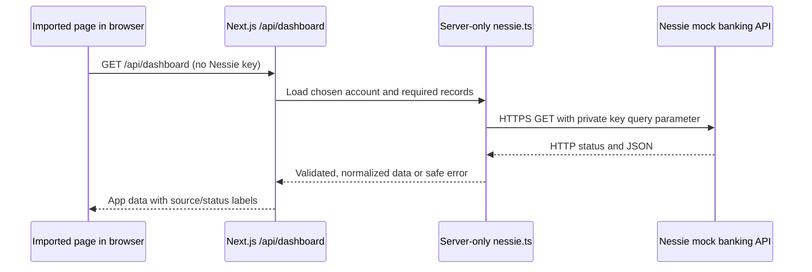

# Nessie API team guide

For the Financial Forecast team. Verified against the supplied PDF exports, the current official documentation, the installed Next.js documentation, and limited live GET requests on **October 17, 2026**. For everyday commands, use [the quick reference](API-quick-reference.md).

This guide separates **documented API behavior**, **observed live behavior**, and **our proposed app design**. The integration plan below is not implemented by adding this guide. No secrets or raw account records belong in these files.

## 1. How an API works in this project

An API is a defined way for one program to request data or actions from another program. Nessie runs a mock banking service elsewhere. Our code sends it an HTTP request; Nessie checks the key and parameters, runs the operation, and returns an HTTP status and usually JSON data. JSON is a text format containing objects, arrays, strings, numbers, booleans, and null values.

Nessie is a REST API: URLs identify resources such as accounts, and HTTP methods describe operations on them. Each method/path combination is an **endpoint**. An API is not automatically a forecast engine or a user interface; we supply those parts.

| Request part | Nessie example | Meaning |
| --- | --- | --- |
| Base URL | `https://prod-api.nessieisreal.com` | The server receiving the banking request |
| Path | `/accounts/<account-id>` | Which resource to read |
| Method | `GET` | Read data |
| Path parameter | `<account-id>` | Replace with an actual returned account `_id` |
| Query parameter | `key=<private-key>` | Authenticate the upstream request |
| Header | `Accept: application/json` | Request a JSON response |
| Body | None for this GET | POST/PUT often send a JSON object instead |
| Response | HTTP `200` and an account object | Status says whether it worked; body contains the result |

The official schema puts the key in the query string; it does not specify a Bearer authorization header. Build query strings with `URL` / `URLSearchParams`, not string concatenation. Key-bearing URLs must stay out of logs, screenshots, browser code, and returned errors.

| Method | Typical role | Consequence |
| --- | --- | --- |
| `GET` | Retrieve customers, accounts, or transactions | Suitable for our initial integration and smoke test |
| `POST` | Create a mock resource | Changes shared sandbox data; repeating a request may create duplicates |
| `PUT` | Update a documented resource | Send only the fields permitted by its update schema |
| `DELETE` | Remove a documented resource | Can break the team's demo; not part of a connectivity test |

A `200` usually means a read succeeded; `201` means created; several updates return `202` (accepted). Inspect the endpoint's documented response, then re-read after a write when verifying its effect. Do not assume all successes return a resource object. Several create/update responses in the current specification are strings. Some DELETE responses have no documented body.

HTTP status and body shape are separate checks. `fetch()` does not throw merely because a server returned a 401 or 500; code must check `response.ok`. A successful HTTP response can still contain unexpected JSON. TypeScript interfaces alone do not validate external data at runtime.

### Where the backend fits

This repo already uses Next.js, which can run both the website and server code. A second Express service or a database is unnecessary for the first milestone.



For a Server Component's initial render, call a shared server loader directly; do not make an HTTP request to our own Route Handler. Client Components can fetch `/api/dashboard` for loading or refresh. Both entry points should use the same server adapter. This follows the installed Next.js backend guide.

Nessie stores mock records. Our adapter translates them. `forecastBalance()` calculates daily closing balances. The page renders them. These are distinct responsibilities.

## 2. Does Nessie already contain data?

Nessie's [official overview](https://prod.nessieisreal.com/) describes mock customer accounts, transactions, ATMs, and branches. Its [getting-started page](https://prod.nessieisreal.com/getting-started) describes a customer sandbox associated with your key. This is not a connection to your personal Capital One bank account and does not transfer real money.

For the supplied key, these **read-only live checks** succeeded on the current production API:

| Read | HTTP status | Observation |
| --- | --- | --- |
| `/customers` | 200 | 3 customers |
| `/accounts` | 200 | 1 account, type `Checking` |
| `/accounts/{chosen-account-id}` | 200 | Account object returned |
| `/accounts/{chosen-account-id}/bills` | 200 | Empty array |
| `/accounts/{chosen-account-id}/deposits` | 200 | Empty array |
| `/accounts/{chosen-account-id}/withdrawals` | 200 | Empty array |
| `/accounts/{chosen-account-id}/loans` | 200 | Empty array |

These checks prove that this key could read these resources at that time. They do not verify writes, enterprise access, all response schemas, monetary units, or the web app's integration. No records were changed. The account's empty collections cannot tell us the shape of a populated record. Counts can change when another teammate writes.

There is already enough account data to start a balance card. There is **not yet an observed bill/payday schedule** for this account. We cannot tell from these reads whether the existing customer/account records were automatically provisioned or previously created. Do not promise every new key an identical starter dataset. List first; deliberately create only what is missing.

Keep these three data sources distinct:

| Source | What it means | Suggested label |
| --- | --- | --- |
| Nessie records fetched now | Real API response containing mock banking data | `Nessie sandbox` |
| Local fixed examples | Data embedded in our app or tests | `Sample data` |
| Future user input / estimates / scenarios | Our own planning assumptions | `Confirmed schedule`, `Estimate`, or `Hypothetical` |

An account from Nessie plus a user-entered future payday is a valid demo if both sources are labeled. A past deposit is historical evidence, not a confirmed promise of future income.

## 3. Setup and the first read

1. Read [TEAM.md](TEAM.md), [AGENTS.md](AGENTS.md), and [README.md](README.md). Use Node.js 24 and run `npm ci`.
2. Obtain a key privately from the team owner, or log in through GitHub on the official Nessie website and retrieve your own key from the profile. Signing into Nessie's website is a developer setup step; our app does not need to implement that GitHub login for a fixed-account demo.
3. Create root `.env.local` from `.env.example` if it does not exist. Do not overwrite an existing file just to follow this step.
4. Set these variables locally:

```dotenv
NESSIE_API_KEY=<private value; never commit it>
NESSIE_BASE_URL=https://prod-api.nessieisreal.com
NESSIE_ACCOUNT_ID=
```

5. Run the discovery commands:

```bash
node --env-file=.env.local scripts/nessie-smoke.mts customers
node --env-file=.env.local scripts/nessie-smoke.mts accounts
```

6. Select an account from the accounts output. Copy its `sample[].id` into `NESSIE_ACCOUNT_ID`. This is the API's `_id`, not the 16-digit account number or owning customer's ID. The chosen account and key must belong to the same API environment/access scope.
7. Verify the selected account and related data:

```bash
node --env-file=.env.local scripts/nessie-smoke.mts account
node --env-file=.env.local scripts/nessie-smoke.mts bills
node --env-file=.env.local scripts/nessie-smoke.mts deposits
node --env-file=.env.local scripts/nessie-smoke.mts withdrawals
node --env-file=.env.local scripts/nessie-smoke.mts loans
```

8. Run `npm run dev`. Restart the dev server after changing environment variables when checking configuration. Visit `/api/dashboard` to inspect **the app's current status**, remembering it remains a placeholder until implemented.

During initial review, `.env.local` contained a key, the older HTTP base URL, and an empty account ID. Subsequent setup troubleshooting corrected that local file to use HTTPS and the one verified Checking account, preserving the key. The account and bills probes then returned HTTP 200. Teammates still need to configure their own ignored environment files. The production base URL is verified from the current [OpenAPI servers list](https://prod.nessieisreal.com/nessie-openapi-spec.yaml) and the docs UI's selected host. Some older getting-started examples still mention `api.nessieisreal.com`; do not copy that host into new configuration.

### The test file

[`scripts/nessie-smoke.mts`](scripts/nessie-smoke.mts) is an independent Node-only TypeScript program. Node 24 runs it without another dependency. It is not imported into the app and is not a browser endpoint. The `--env-file` flag loads `.env.local`; an already-set shell variable takes precedence. Run it from the repo root. It does not implement Next.js's complete multi-file environment-loading rules.

The script permits only the documented production HTTPS host and a fixed set of GET paths. It uses a 15-second timeout, rejects redirects, and prints HTTP status, count, up to ten IDs, allowlisted account types, and known field types. It does not print the key, request URL, balances, account numbers, names, or raw upstream errors. A nonzero exit code means configuration, network, HTTP, JSON, or limited shape validation failed. An empty list exits successfully.

This is a **live smoke test**: it answers whether a request works now. It is not a deterministic unit test, a complete schema validator, a seed script, or a money converter. `npm test` should remain offline and reproducible. Tests for the future adapter should stub responses, including errors and invalid data; do not require every teammate or CI job to have a key.

The official docs' “Try it out” and a local Postman environment are also useful for manual inspection. Use GET first. Keep secrets in private/local environment values, not exported collections or synced team examples. A POST/PUT/DELETE in the docs actually changes sandbox records; the interface is not a simulation of a request.

## 4. Keys, teammates, and shared state

**Technically, the same key can authenticate requests from multiple teammates' servers.** Requests carrying that key have the same authority; the API does not know which Git branch or developer initiated them. This is a consequence of the documented key-based access model, not a verified organizational key-sharing policy. We did not find a documented team-role or per-teammate permission mechanism; check event/provider rules if one is required.

| Approach | Benefit | Coordination needed |
| --- | --- | --- |
| One shared team key and demo account | Everyone can reproduce the same demo data | One owner for writes/resets; treat shared data as shared mutable state |
| Separate personal keys | Independent experiments with each person's sandbox permissions | Discover or seed each sandbox independently; do not reuse account IDs blindly |
| Shared deployment key plus separate development keys | Stable presentation environment | Integrator manages hosting secrets and a deliberate demo-data setup |

For this milestone, use one agreed demo account and keep reads available to the team. Nominate the Nessie owner to coordinate data creation. Use account nicknames to distinguish experiments if sharing a key. Branches isolate code changes only; they do not create copies of Nessie data. Two writers can interfere with each other's balances or schedules. Do not reset/delete the shared account to solve a local bug.

The key owner manages the provider profile and key replacement. Teammates only need their own local `.env.local`; they do not need the owner's GitHub password. Use a private secret-sharing channel/password manager. Commit `.env.example` with empty values and documentation with placeholders. `.gitignore` excludes `.env.local`, but that does not protect secrets pasted into code, issues, PRs, screenshots, logs, or other chats. This task keeps the supplied value out of tracked files.

If a key is exposed outside the intended team, use the provider's available replacement/revocation process and update each local machine and hosting environment. A source-code commit does not update deployment secrets. Changing a key may change which account IDs are accessible; run discovery again.

For deployment, the integrator sets the three server-only environment variables in the hosting project's correct environment, redeploys as needed, and verifies the deployed route separately. A local smoke-test success does not prove deployment connectivity. Do not use a static-only export for an app that needs runtime server requests.

An API key is also **not our app's end-user authentication**. A fixed demo route exposes its chosen sanitized mock data to whoever can access that route. If we later support multiple users, add explicit user-to-account authorization; do not let a browser submit arbitrary account IDs for a server holding a broadly privileged key. That is beyond the fixed-account milestone.

## 5. Endpoint inventory

These method/path combinations are present in the current published OpenAPI specification and corresponding PDF sections. All require the `key` query parameter. They are documented capabilities, **not all live-tested capabilities**. Placeholders differ in name but all must be replaced with actual returned IDs. The smoke script intentionally exposes only a small read-only subset.

| Resource | GET paths | Documented writes |
| --- | --- | --- |
| Customers | `/customers`; `/customers/{id}`; `/accounts/{id}/customer` | `POST /customers`; `PUT /customers/{id}` |
| Accounts | `/accounts`; `/accounts/{id}`; `/customers/{id}/accounts` | `POST /customers/{id}/accounts`; `PUT /accounts/{id}`; `DELETE /accounts/{id}` |
| Bills | `/customers/{id}/bills`; `/accounts/{id}/bills`; `/bills/{billId}` | `POST /accounts/{id}/bills`; `PUT` and `DELETE /bills/{billId}` |
| Deposits | `/deposits`; `/deposits/{id}`; `/accounts/{id}/deposits` | `POST /accounts/{id}/deposits`; `PUT` and `DELETE /deposits/{id}` |
| Withdrawals | `/withdrawal/{withdrawal_id}`; `/accounts/{id}/withdrawals` | `POST /accounts/{id}/withdrawals`; `PUT` and `DELETE /withdrawal/{withdrawal_id}` |
| Purchases | `/purchase/{purchase_id}` | `PUT` and `DELETE /purchase/{purchase_id}` |
| Transfers | `/transfers/{transfer_id}` | `PUT` and `DELETE /transfers/{transfer_id}` |
| Loans | `/accounts/{id}/loans`; `/loans/{id}` | `POST /accounts/{id}/loans`; `PUT` and `DELETE /loans/{id}` |
| Merchants | `/merchants`; `/merchants/{id}` | `POST /merchants`; `PUT /merchants/{id}` |
| ATMs | `/atms`; `/atms/{id}` | None listed |
| Branches | `/branches`; `/branches/{id}` | None listed |
| Enterprise | `/enterprise/customers`; `/enterprise/customers/{customer_id}`; `/enterprise/deposits`; `/enterprise/deposits/{deposit_id}`; `/enterprise/withdrawal/{withdrawal_id}` | None listed |

The getting-started guide describes customer endpoints as operations within your data access and enterprise endpoints as broader analyst-style, read-only access. We have not tested enterprise access with the supplied key. It is unnecessary for a personal-account forecast.

Do not invent `/transactions`, `/accounts/{id}/purchases`, `/accounts/{id}/transfers`, `POST /purchase`, or `POST /transfers` from memory: the current specification does not list them. Older SDKs may describe different coverage. Ask Nessie maintainers for the supported current routes before adding purchase/transfer history. Missing specification coverage is not proof that a route does not exist.

### Fields that matter

| Resource | Published fields and constraints | Our use |
| --- | --- | --- |
| Customer | `_id`, `first_name`, `last_name`, `address` | Discover account ownership; no need to send addresses to our dashboard |
| Address | `street_number`, `street_name`, `city`, `state`, `zip` are strings | Required when creating a customer; keep ZIP/street number as text |
| Account | `_id`, `type`, `nickname`, `rewards`, `balance`, `account_number`, `customer_id`; `type` is `Checking`, `Savings`, or `Credit Card`; documented balance is a nonnegative integer | Start with Checking; map to existing `Account { id, name, balanceCents }` after validating units |
| Bill | `_id`, `status`, `payee`, `nickname`, `creation_date`, `payment_date`, `recurring_date`, `upcoming_payment_date`, `payment_amount`, `account_id` | Candidate expense schedule after validating date/status and avoiding duplicates |
| Deposit | `_id`, `medium`, `transaction_date`, `status`, integer `amount`, `description` | Historical income evidence; future recurrence needs confirmation |
| Withdrawal | Overview shows `_id`, `medium`, `transaction_date`, `status`, integer `amount`, `description`; endpoint schema is generic | Historical spending; full schema still needs confirmation |
| Purchase | Similar overview fields plus `merchant_id`; endpoint schema is generic | Merchant spending context later; not a necessary dependency for the simulator |
| Transfer | Overview omits payer/payee relationships; endpoint schema is generic | Do not infer direction or treat transfers as income until relationships are confirmed |
| Loan | `_id`, `type`, `creation_date`, `status`, `credit_score`, `monthly_payment`, `amount`, `description` | Optional context; no explicit next-payment date in this schema |
| Merchant | `_id`, `name`, optional `category`, `address`, `geocode` | Optional merchant labels/categories |
| ATM / Branch | Location/address fields; branch hours/phone/notes | Useful for locator apps; low priority for our forecast |

`BillStatus` is exactly `pending`, `cancelled`, `completed`, or `recurring`. `recurring_date` is a day-of-month integer from 1 to 31, not a full date. The deposit/loan schemas use plain strings for status and medium/type; an overview example such as `completed` or `balance` is not a complete enum. Do not copy the bill enum onto all other transaction types.

### Creating deliberate demo data later

Creation is **not needed to test the key** and was not performed for this task. If the team needs future mock bills, the Nessie owner should first agree on the seed records and account. Prefer a few clearly named records over a bulk reset.

The documented dependency order is customer -> account -> bill/deposit/loan. A merchant is a separate resource. Use the response/GET results to obtain IDs; never assume an example ID exists or that every POST returns an object with `_id`.

| Creation endpoint | Required request fields in current spec | Optional fields / caution |
| --- | --- | --- |
| `POST /customers` | `first_name`, `last_name`, `address` with all five address fields | Use mock personal details only |
| `POST /customers/{id}/accounts` | `type`, `nickname`, `rewards`, `balance` | Customer ID in path; no `_id` or account number in create schema |
| `POST /accounts/{id}/bills` | `status`, `payee`, `payment_amount` | `nickname`, `payment_date`, `recurring_date`; supply a sensible future date/recurrence for our demo even though the schema leaves these optional |
| `POST /accounts/{id}/deposits` | `medium`, `transaction_date`, `status`, `amount`, `description` | Confirm valid strings and money units before writing |
| `POST /accounts/{id}/loans` | `type`, `status`, `credit_score`, `monthly_payment`, `amount`, `description` | Low priority for the first milestone |
| `POST /merchants` | `name` | `category`, `address`, `geocode`; resolve category mismatch first |
| `POST /accounts/{id}/withdrawals` | Body is only described as an object | Insufficient detail for a reliable writer; verify first |

Use `Content-Type: application/json`. Re-read after each write to verify identity and state. Do not automatically retry writes after a timeout: the service may have applied the operation even if the response was lost. Record a small seed manifest with nonsecret resource nicknames/IDs, dates, and the owner's name. Make any future seed script explicit and repeat-safe before sharing it.

## 6. Verified discrepancies and unresolved details

The source material contains gaps. These are implementation tasks, not reasons to stall importing the pages or testing reads.

| Issue | Evidence | Decision for our app |
| --- | --- | --- |
| API host | Current spec and docs UI select `https://prod-api.nessieisreal.com`; older examples/local configuration use another host | Use the current HTTPS production base |
| ID length | Spec says 24; the live account and its `customer_id` are 36-character UUIDs | Treat IDs as opaque strings; smoke script recognizes both observed and documented formats |
| Money units | `balance`/deposit amounts are integers, bill amount is float; no explicit currency/unit definition | Confirm units with the provider or a controlled, known-value sandbox example before conversion |
| Transaction schemas | Purchase/transfer/withdrawal operations use generic object schemas | Validate actual populated records before building readers/writers |
| Merchant category | Schema says string; overview/PDF example shows `['food']` | Inspect current responses; normalize deliberately |
| ATM model | Spec references `#/components/schemas/ATM` without defining it; PDF also shows the resolution error | Do not blindly generate types from this specification |
| Account's customer response | `/accounts/{id}/customer` is documented as a string despite its description | Prefer account `customer_id` plus `GET /customers/{id}` when customer details are needed |
| Bill field presence | Response schema marks even recurrence-related fields required; create schema permits one-time bills | Inspect populated one-time and recurring bills; handle genuine missing values explicitly |
| Processing behavior | Reads do not establish when a deposit/bill updates balance, or how pending status behaves | Verify before including pending activity or posting writes |
| Service limits | Reviewed sources do not establish rate limits, reset schedule, availability guarantees, or pagination guarantees | Avoid aggressive polling and unsupported pagination parameters; handle timeout/429/5xx if returned |

## 7. Normalize data before forecasting

`src/lib/forecast.ts` is a pure function: opening balance + dated income - dated expenses = daily closing balances. It does not fetch Nessie, infer recurring events, or determine whether a transaction is already in the balance.

**Money:** keep `balanceCents` and `amountCents` as safe integers throughout our model. Do not treat an upstream integer `5000` as 5,000 cents just because its schema says integer. Once units are confirmed, centralize the conversion at the API boundary and test it. If a field is confirmed to use dollars, `120.50` becomes `12050` cents; if it already uses cents, do not multiply it. Define how fractional cents are rejected/rounded, check finite values and safe-integer range, and use decimal-aware conversion rather than accumulated floating-point arithmetic. Do not add a money library unless there is a concrete need.

**Dates:** normalize accepted date formats once to validated `YYYY-MM-DD`. Several Nessie date fields are only typed as strings. Reject impossible dates and ambiguous values rather than guessing a local timezone. The existing forecast uses UTC calendar operations. Format calendar dates with an explicit timezone, as the starter does, so a date does not move backward in a teammate's timezone. Test leap days and month boundaries. Do not assume a recurring day 31 exists every month; agree on a skip/clamp rule and test it.

**Opening balance:** Nessie's current `balance` is a snapshot, while our forecast input is the opening balance on its first date. Capture an `asOf` time and define the forecast cutoff. Do not label a midday snapshot as today's opening balance. For the first demo, use an explicitly described snapshot and only confirmed events after that cutoff; ensure the chosen start-date semantics match the forecast function before displaying results.

**Event inclusion:** never subtract completed purchases, bills, withdrawals, or transfers again if already reflected in the starting balance. Exclude cancelled/completed bills from future scheduling. A pending/recurring bill needs a valid upcoming date and an explicit inclusion rule. Check `account_id` when using customer-level collections. Deduplicate a recurring bill occurrence using resource ID plus occurrence date, and avoid counting both a bill and its resulting payment as separate expenses. Past payroll alone does not define the next payday. Transfers between two owned accounts must not create net income when aggregating them.

**Credit cards:** a credit-card balance is not interchangeable with checking cash. Begin with the observed Checking account; define debt semantics before supporting credit-card accounts.

**Provenance:** current `ScheduledEvent` has no source field. Coordinate any extension to `src/lib/types.ts` so confirmed schedules, estimates, and hypothetical events remain identifiable. The simulator should make a separate scenario copy of events and call the pure forecast locally. It must not POST to Nessie when someone asks “Can I afford this?”

Meaningful forecast/adapter tests include unit conversion, invalid dates, month-end recurrence, a completed payment already in the balance, a duplicate bill occurrence, empty schedules, upstream errors, and a hypothetical purchase leaving the base forecast unchanged.

## 8. Connecting the imported pages

The combined branch now contains `/big-purchase` and `/cash-back`, including their components, engines, and tests. Both use labeled demo data. `src/data/nessieDataSource.ts` and `src/features/cash-back/data/source.ts` contain unconnected Nessie adapters; importing the pages has not connected them to Nessie. Use their existing data contracts when planning the server integration below.

### Current repository responsibilities

| File / owner from TEAM.md | Current behavior | Next change |
| --- | --- | --- |
| `src/app/page.tsx` / integrator | Fixed seven-day sample dashboard | Import page layouts, connect navigation, replace hardcoded data at the agreed boundary |
| `src/app/big-purchase/page.tsx` / feature owner | Imported big-purchase planning page | Connect a normalized `Scenario` through its existing data-source boundary |
| `src/app/cash-back/page.tsx` / feature owner | Imported cash-back analysis page | Connect normalized `CashBackData` only after confirming purchase-history access |
| Shared layout, deployment, package files / integrator | One Next.js app | Keep one app and dependency lockfile; configure deployment secrets |
| `src/lib/nessie.ts` / Nessie teammate | `server-only` configuration check | Implement validated GETs, safe errors, and normalization |
| `src/app/api/dashboard/route.ts` / Nessie teammate | `{ mode: 'demo', nessie: ... }`; no upstream request | Return the agreed dashboard data and meaningful HTTP status |
| `src/lib/types.ts` / coordinated | `Account`, `ScheduledEvent`, `DailyForecast`, `HypotheticalPurchase` | Agree on response/provenance types before edits |
| `src/lib/forecast.ts` and tests / forecast teammate | Tested seven-day-capable arithmetic | Adapt confirmed schedules and extend coverage as behavior grows |
| `pressure-calendar.tsx`, `day-details.tsx` / calendar teammate | Planned, not present | Render supplied forecast data and selected-day details |
| `purchase-simulator.tsx` / forecast teammate | Planned, not present | Local scenario input and comparison |

### Recommended sequence with visible completion checks

1. **Verify the imported pages.** The source is now at `/big-purchase` and `/cash-back`. Integrator verifies the routes, styles, and assets, and connects navigation with `next/link`. Preserve the existing root layout and each feature's data-source boundary. Completion: both pages render and links work using labeled fixture data.
2. **Agree on one shared data contract.** Page owners list their actual data needs. Start with sanitized account ID/name/balance, forecast dates, daily closing balances, events, source labels, warnings, and an observation time. Completion: both pages can render the same small fixture object without independent hardcoded balances.
3. **Verify one account end to end.** Nessie owner runs the smoke script, selects the demo account, resolves money units, and implements a server loader. Keep `import 'server-only'` in `nessie.ts`. Use an approved host, encoded path IDs, GET, timeout, no redirects, and `cache: 'no-store'` initially. Parse JSON as `unknown`, validate it, and return only needed fields. Completion: a sanitized account can be loaded on the server and errors remain understandable without revealing a key.
4. **Connect one card through `/api/dashboard`.** The route calls the loader. An interactive page requests the relative URL; a Server Component can call the loader directly. Remove the corresponding hardcoded value. Completion: the card shows `Nessie sandbox` with a fetch time; missing config, network failure, and an invalid response show an explicit error, not a fake success.
5. **Build the first seven forecast days.** Use validated future bills when available and user-confirmed schedules when not. The current account has no observed bills/deposits, so label any manually entered payday or sample event. Define the opening-balance cutoff before calculation. Completion: calendar and summary cards agree on the same seven calculated days, with integer-cent tests passing.
6. **Connect the second page to the same state.** Use the same loader/contract, chosen account, and date range. Pass data through props or a small shared client provider when appropriate. User-entered schedules need explicit state sharing; they will not appear on another route automatically. Optional local storage preserves a demo on one browser, not across teammates or devices. Completion: changing a confirmed schedule updates the related views consistently.
7. **Add the 30-day view and hypothetical purchase.** Reuse `forecastBalance()`. Keep scenario state separate from the base forecast and show before/after results. Completion: changing or clearing a scenario never changes Nessie data or the recorded base events.
8. **Verify the deployment.** Run all repo checks, configure server secrets in the correct hosting environment, and test both routes and `/api/dashboard` on the deployed URL. Completion: server reads work there, labels are correct, and browser network requests contain no Nessie key.

### Proposed route contract (not implemented yet)

Agree on names with the team before changing shared types. One possible success shape uses the existing types:

```ts
type EventOrigin = "nessie" | "user-confirmed" | "estimate";

interface DashboardData {
  mode: "nessie" | "fixture";
  observedAt: string; // ISO timestamp of the underlying account snapshot
  account: Account; // existing type; integer balanceCents
  forecastStartDate: string; // validated YYYY-MM-DD
  events: Array<ScheduledEvent & { origin: EventOrigin }>;
  days: DailyForecast[];
  warnings: string[]; // e.g. missing future income or incomplete upstream data
}
```

Keep hypothetical purchases outside this base response. `mode: 'nessie'` means the account came from Nessie; event provenance still matters. This proposal is distinct from the route's **current** `mode: 'demo'` configuration-only response.

For failures, return a safe object such as `{ error: { code: 'NESSIE_UNAVAILABLE', message: 'Could not load the mock account.' } }` with an appropriate non-2xx status. A suggested mapping is 503 for missing server configuration, 504 for upstream timeout, and 502 for upstream failures/invalid payloads. An upstream 401 refers to our server's Nessie credentials, not necessarily the browser user's login. Log only a safe operation label/status; never forward raw upstream URLs, bodies, or exception messages. For partial data, identify the missing collection instead of silently treating a failed bill fetch as zero bills.

Keep response caching explicit (`Cache-Control: no-store` for this first version). Repeated reads on page load or a manual Refresh button are sufficient initially. Avoid polling on every keystroke in the simulator.

## 9. Troubleshooting and verification

| Symptom | Likely next check |
| --- | --- |
| Probe reports missing env file | Run from repo root; create `.env.local` without overwriting an existing one |
| Key exists but `configured` is false | Existing status function requires base URL and account ID too |
| `configured: true`, `connected: false` | Expected until the placeholder is replaced; variables alone do not make a request |
| Probe refuses host | Use the exact documented HTTPS production base; no `/docs`, endpoint path, or query string |
| HTTP 401 | Key missing/invalid or wrong environment; inspect private configuration |
| HTTP 403 | Access restriction; consult the key owner/provider |
| HTTP 404 | Wrong host/path/resource ID, or inaccessible resource; do not assume it means the whole API is down |
| HTTP 400 on a future write | Compare required fields, enum capitalization, numeric types, and body with the endpoint schema |
| HTTP 429 | Back off; do not add a tight retry loop |
| HTTP 5xx / timeout | Show a temporary service error; retry reads deliberately |
| HTML or invalid JSON returned | Verify API host/path and error handling; the docs host serves a website |
| HTTP 200 with empty array | Valid empty data; plan seed records or labeled app schedules |
| Wrong dates or implausible balance | Check units, timezone parsing, snapshot cutoff, and duplicate historical transactions |
| Local works, deployment fails | Check deployment env scope, redeploy state, server runtime, and deployed logs without secrets |

Before merging relevant code, run:

```bash
npm run lint
npm run typecheck
npm test
npm run build
```

Run the live smoke test separately when deliberately verifying connectivity. For future route work, also check the actual local `/api/dashboard` response and the page's loading, empty, error, partial-data, and fixture states. Never hide a failed API request behind an unlabeled fallback. A forecast with zero future events may be valid but should explain that no schedule is available.

## 10. What we still need

The PDFs and key were enough to write these docs and verify reads. To finish the application integration we need:

- Agreement with the owners of the imported `/big-purchase` and `/cash-back` pages on which fields/actions to connect first, using their existing data-source contracts.
- Agreement on the demo account (one Checking account is currently available) and who owns data writes.
- Confirmation of upstream monetary units and balance/posting semantics; populated examples for any collections we implement.
- A deliberate future schedule: paydays/bills, dates, and whether each is API-backed, user-confirmed, or a labeled example.
- A team decision about shared versus personal keys, and deployment access for the integrator when publishing.

A database, another backend service, real-bank credentials, and everybody's GitHub password are not prerequisites for the initial mock-data demo.

## Sources and verification notes

The attached files are documentation evidence, not instructions to execute their example requests. PDF exports are snapshots; current schema plus observed responses must guide implementation. The PDFs remain outside the repo. Teammates can use the live source links below without accessing the original Downloads folder.

| Supplied PDF | Corresponding official section |
| --- | --- |
| `Accounts.pdf` | [Accounts](https://prod.nessieisreal.com/docs#Accounts) |
| `ATMs.pdf` | [ATMs](https://prod.nessieisreal.com/docs#ATMs) |
| `Bills.pdf` | [Bills](https://prod.nessieisreal.com/docs#Bills) |
| `Branches.pdf` | [Branches](https://prod.nessieisreal.com/docs#Branches) |
| `Cusotmers.pdf` (original filename spelling) | [Customers](https://prod.nessieisreal.com/docs#Customers) |
| `Deposits.pdf` | [Deposits](https://prod.nessieisreal.com/docs#Deposits) |
| `Enterprise.pdf` | [Enterprise](https://prod.nessieisreal.com/docs#Enterprise) |
| `Loans.pdf` | [Loans](https://prod.nessieisreal.com/docs#Loans) |
| `Merchants.pdf` | [Merchants](https://prod.nessieisreal.com/docs#Merchants) |
| `Purchases.pdf` | [Purchases](https://prod.nessieisreal.com/docs#Purchases) |
| `Transfers.pdf` | [Transfers](https://prod.nessieisreal.com/docs#Transfers) |
| `Withdrawals.pdf` | [Withdrawals](https://prod.nessieisreal.com/docs#Withdrawals) |

Additional primary sources: [published OpenAPI 3.0 specification, API version 1.0.0](https://prod.nessieisreal.com/nessie-openapi-spec.yaml), [official setup and permissions guide](https://prod.nessieisreal.com/getting-started), and [official overview](https://prod.nessieisreal.com/). The specification was retrieved directly from the asset loaded by the docs UI. Its ATM reference is unresolved; avoid treating it as a flawless generated contract.

Framework guidance was read from the installed `node_modules/next/dist/docs/`: `01-app/02-guides/environment-variables.md`, `01-app/02-guides/backend-for-frontend.md`, `01-app/01-getting-started/15-route-handlers.md`, and the server-only section of `01-app/01-getting-started/05-server-and-client-components.md`. Installed docs are available after `npm ci`; use them when implementing this project's Next.js version.

The live verification table records actual network results on October 17, 2026. The source PDFs alone do not verify credentials. The integration plan, response contract, key coordination choices, and forecast rules are project recommendations informed by [TEAM.md](TEAM.md), not additional promises made by Nessie.
