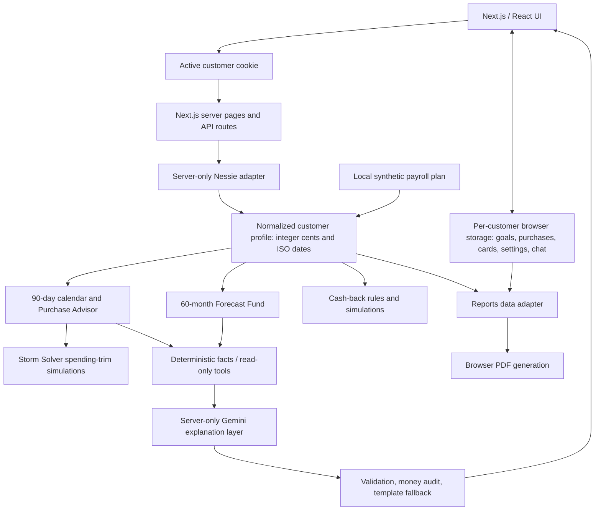

# SwampHacks technical judging preparation

Reviewed against baseline `a22be0f` and the changes on `codex/demo-readiness-audit`, October 18, 2026. See [verification and remaining risks](SWAMPHACKS_AUDIT.md) and the [demo runbook](SWAMPHACKS_DEMO_RUNBOOK.md). Paths below are relative to the repository root.

## A. Thirty-second technical overview

“Financial Forecast helps people with tight cash flow see what a purchase would do before making it. We read synthetic banking customers, cash balances, transactions, bills, and loans from Capital One Nessie. Our TypeScript engines turn those records and clearly labeled planning assumptions into daily financial weather, purchase checks, and savings plans. Gemini explains computed facts through read-only tools. It does not move money or calculate the forecast.”

## B. Architecture

The active-customer resolver is the authority for the selected profile. Server pages provide that customer's data to client components; browser state is keyed by the server-provided customer ID. Calendar and Forecast Fund share date/schedule conventions but serve different horizons and purposes. The PDF renderer runs in the browser; its optional summary runs through the server AI policy. No database, separate backend service, authentication provider, or real-bank connector is implemented.

### Actual Nessie usage

| Runtime endpoint | Data | Consumers | Operation |
| --- | --- | --- | --- |
| `GET /customers` | Available IDs and names | Profile selector; active-customer validation | Read |
| `GET /customers/{id}/accounts` | Checking/savings balances and credit-card nicknames | All financial pages; card-catalog matching | Read |
| `GET /accounts/{id}/deposits` | Completed deposits and dates | Recorded history, income inference, reports | Read |
| `GET /accounts/{id}/withdrawals` | Completed withdrawals and dates | Spending categories, recorded history, reports | Read |
| `GET /accounts/{id}/bills` | Recurring/pending bills, amounts and schedules | Calendar, Advisor, Storm Solver, Fund, reports | Read |
| `GET /accounts/{id}/loans` | Approved loans and monthly payments | Debt summaries; payments require separate bill schedules | Read |

Activity is loaded for checking and savings accounts. The wrapper also defines customers/accounts/deposits/withdrawals/bills/loans creation functions and additional resource readers, but those are **not ordinary UI operations**. Seed scripts deliberately create synthetic data. The existence of a helper is not evidence that a page uses it. Card-level purchases, merchants, transfers, ATMs, and branches are not runtime profile inputs. Source: `src/lib/nessie-api.ts`, `src/lib/nessie-profile.ts`, `scripts/seed-nessie.mts`, `scripts/seed-nessie-history.mts`.

### Data provenance to explain aloud

| Data | Authority |
| --- | --- |
| Names, balances, completed deposit/withdrawal records, bill schedules, loan records | Live reads from the Nessie **synthetic sandbox** |
| Seeded customers' future payroll schedule | Local `data/nessie-demo/plan.json`, matched by account nickname |
| Other customers' future income | Inferred cadence from deposits; a single pay-like deposit is a labeled monthly estimate; insufficient evidence produces no income schedule |
| Everyday spending | Up to six months of classified withdrawals, with a history-coverage note |
| Hypothetical purchases, goals, card edits, critical threshold | Customer-specific browser storage; no Nessie writes |
| Reward rates, caps, categories, annual fees | Local card catalog; simulated rewards, not issuer-credited earnings |
| Daily balance, risk, savings contributions, rescue plans | Deterministic engines |
| Conversational wording and explanations | Gemini or labeled deterministic templates |

## C–D. Twenty-five likely questions and defensible answers

### 1. How does the forecast work?

- **Say:** “We walk forward from Nessie's cash snapshot, adding dated income and subtracting bills, estimated spending, and hypothetical purchases.”
- **Technical basis:** Integer cents; next-day scheduled events avoid replaying transactions already included in the snapshot. Calendar supports 90 days after today; Fund supports 60 months.
- **Source:** `calendar/engine/model.ts`, `calendar/engine/entries.ts`, `big-purchase/engine/base.ts` under `src/features/`.
- **Follow-up:** What happens when a paycheck and rent occur on the same day?
- **Caveat:** End-of-day estimates do not model posting order or bank fees.

### 2. Why is Nessie necessary?

- **Say:** “It supplies the customer, accounts, balances, transaction history, bills, and debt that make the forecast customer-specific.”
- **Technical basis:** The server loads the selected customer's records, normalizes them once, and supplies all financial features. A failed read shows an error instead of silently substituting fixtures.
- **Source:** `src/lib/nessie-profile.ts`, `src/lib/active-customer.ts`.
- **Follow-up:** Which inputs do you add locally?
- **Caveat:** Nessie is a banking sandbox; this is not a real bank connection.

### 3. Which Nessie endpoints do you use?

- **Say:** “Customers, a customer's accounts, and each cash account's deposits, withdrawals, bills, and loans.”
- **Technical basis:** The runtime endpoint table above lists the actual read path. Seeding is separate from ordinary use.
- **Source:** `src/lib/nessie-api.ts`, `loadCustomerProfile()` in `src/lib/nessie-profile.ts`.
- **Follow-up:** Do you read actual card purchases?
- **Caveat:** No; card accounts identify locally modeled cards by nickname.

### 4. How are transactions categorized?

- **Say:** “Our generated records carry explicit category tags. Other records use readable keyword rules.”
- **Technical basis:** `classifyTransaction()` separates spending, bills, one-offs, savings, transfers, income and interest. Everyday spending maps into shared categories and cash-back categories.
- **Source:** `src/lib/spending-categories.ts`.
- **Follow-up:** What if a merchant's name is ambiguous?
- **Caveat:** Untagged keyword classification is approximate. A deposit is not proof of recurring payroll; refunds are excluded from payroll inference.

### 5. How do you estimate income?

- **Say:** “Seeded profiles have explicit local paycheck plans. Otherwise we look for similar deposits on a weekly, biweekly, or monthly cadence.”
- **Technical basis:** Group by normalized label, compare amounts within 25% of the lower median, infer cadence from gaps and reject stale series. Without a series, only a pay-like deposit can become a labeled monthly estimate.
- **Source:** `estimateIncome()` in `src/lib/nessie-profile.ts`, `src/lib/plan-assumptions.ts`.
- **Follow-up:** Can two similar deposits be coincidence?
- **Caveat:** Yes. This is an estimate, not employer-confirmed future income; the app cannot confirm or edit the inferred schedule yet.

### 6. How do you estimate spending?

- **Say:** “We average classified everyday withdrawals over available history, up to six months, and project a weekly allowance.”
- **Technical basis:** One-offs, recorded bill payments, savings and internal transfers are excluded where classified. Weekly cents are `round(monthlyCents × 12 / 52)`.
- **Source:** `monthlySpendByCategory()` in `src/lib/nessie-profile.ts`, `weeklySpendingCents()` in `big-purchase/engine/events.ts`.
- **Follow-up:** Why is the allowance on Saturdays?
- **Caveat:** Saturday is a modeling convention, not a prediction of merchant purchases; rounding can differ slightly from an exact annual total.

### 7. What happens with incomplete history?

- **Say:** “We show how much history the estimate uses and explicitly flag thin history.”
- **Technical basis:** `spendingCoverage()` reports observation span and spending-record count; empty history yields no invented spending or income.
- **Source:** `src/lib/nessie-profile.ts`, `forecastEstimateNote()` in `src/lib/data-source.ts`.
- **Follow-up:** Does an empty spending estimate mean no expenses?
- **Caveat:** No. Missing data can understate expenses; the coverage labels are heuristics, not a completeness guarantee.

### 8. How accurate is the forecast?

- **Say:** “The arithmetic is deterministic and tested, but we have not measured predictive accuracy.”
- **Technical basis:** Identical inputs produce identical results; source labels distinguish snapshots, schedules, and assumptions.
- **Source:** `src/features/calendar/engine/*.test.ts`, `src/features/big-purchase/engine/*.test.ts`.
- **Follow-up:** How would you measure it?
- **Caveat:** Backtesting against later observed balances is future work. Do not give an invented accuracy percentage.

### 9. Why deterministic calculations instead of ML?

- **Say:** “We need numbers that can be reproduced and explained, especially when someone is close to running out of cash.”
- **Technical basis:** Dates, balance changes, thresholds and contribution scans are ordinary tested TypeScript. Gemini receives computed facts.
- **Source:** Calendar and Fund engine directories; `src/lib/ai/facts/`.
- **Follow-up:** Could ML improve the assumptions later?
- **Caveat:** Deterministic arithmetic does not make uncertain input assumptions correct.

### 10. What does Gemini actually do?

- **Say:** “It makes computed results easier to understand and chooses read-only financial tools in chat.”
- **Technical basis:** Ask, Advisor explanations, goal summaries, merchant categorization, card comparison, and report summary use server-only routes.
- **Source:** `src/lib/ai/server/`, `src/app/api/`, `docs/AI_LAYER.md`.
- **Follow-up:** What happens when Gemini is unavailable?
- **Caveat:** Financial features continue using deterministic templates; chat fallback is a baseline overview, not a substitute answer to every possible question.

### 11. How do you reduce hallucinations?

- **Say:** “We compute facts first, limit tools to read-only functions, validate outputs, audit supported dollar formats, and fall back when the audit fails.”
- **Technical basis:** Chat answer text is withheld until auditing completes; only progress events stream early. Invalid answers are neither displayed nor cached.
- **Source:** `src/lib/ai/audit.ts`, `server/ask.ts`, `server/generate.ts`.
- **Follow-up:** Does that prove the prose is correct?
- **Caveat:** No. Percentages, dates, sign/context errors and wrong recommendations can escape a value-membership audit. The deterministic UI verdict is authoritative.

### 12. Does Nimbus use the same purchase calculation as Advisor?

- **Say:** “Yes. Its checkPurchase tool calls the same facts builder and purchase engine.”
- **Technical basis:** The server reloads the active customer; the browser supplies validated hypothetical purchases and the critical threshold. Cache keys include full financial context, not just the short baseline.
- **Source:** `src/lib/ai/server/tools.ts`, `src/lib/ai/facts/advisor.ts`, `src/lib/ai/server/context.ts`.
- **Follow-up:** Can the wording still be wrong?
- **Caveat:** The tool's numbers match; unconstrained natural-language interpretation is not guaranteed to match.

### 13. How does Purchase Advisor determine risk?

- **Say:** “We insert the hypothetical purchase, find the lowest balance from its date onward, and compare it with your critical threshold.”
- **Technical basis:** Six bands: below zero; at/below critical; then below critical + $200, + $700, + $1,200; otherwise thriving. Default critical is housing. A separate check tracks the paying account.
- **Source:** `purchaseCheck.ts`, `balanceThresholds.ts` in `src/features/calendar/engine/`.
- **Follow-up:** What does a safer date mean?
- **Caveat:** It is the earliest later date whose remaining forecast is at caution or better, within the finite window; it is not a payment guarantee.

### 14. How does Forecast Fund choose contributions?

- **Say:** “It scans $5 increments for money you could set aside each payday while preserving the cash buffer.”
- **Technical basis:** A 60-month base projection, actual scheduled paydays, capped final contribution, a suggestion capped at 20% of the smallest paycheck, and a separate never-negative limit. Existing cash shortfalls now reject safe contribution candidates and produce alerts.
- **Source:** `src/features/big-purchase/engine/{base,plan,limits,forecast}.ts`.
- **Follow-up:** What if I enter more than that limit?
- **Caveat:** The hypothetical plan can be shown as a warning; a mechanically funded earmark is not a feasible purchase date when cash goes negative.

### 15. What happens if income stops?

- **Say:** “The current baseline assumes its configured or inferred paychecks continue. It cannot predict job loss.”
- **Technical basis:** Scenario income sources generate recurring events; no lost-income chat tool or UI scenario is implemented.
- **Source:** `src/features/big-purchase/engine/events.ts`, `src/lib/ai/server/tools.ts`.
- **Follow-up:** Could you model a stopped paycheck?
- **Caveat:** That needs an explicit user-controlled scenario. Nimbus should acknowledge that limitation, not invent a recalculated outcome.

### 16. How does Storm Solver work?

- **Say:** “It identifies pressure in the same calendar forecast and simulates bounded spending trims to see whether the weather improves.”
- **Technical basis:** Greedy trim steps, per-category cut limits, protected categories, and three tiers. Every candidate re-runs the calendar; unmet targets report additional cash needed.
- **Source:** `src/features/storm/engine/rescue.ts`, `src/features/calendar/engine/stormAdvice.ts`.
- **Follow-up:** Does it move rent or cancel bills?
- **Caveat:** No Nessie bills are marked flexible. The displayed $35-per-overdraft-day cost illustration is a local assumption, not a known bank fee.

### 17. How are credit-card rewards calculated?

- **Say:** “We compare local card rules against estimated category spending, tracking caps and assigning spending to the best available rate.”
- **Technical basis:** Rates convert to integer basis points; rewards accumulate as cents × basis points and round per card/category. Monthly, quarterly and yearly cap ledgers support the simulation; fees are considered for card-addition suggestions.
- **Source:** `src/features/cash-back/engine/rewards.ts` (including `CapLedger`), local catalog.
- **Follow-up:** Do you know how much of my real cap is used?
- **Caveat:** No card-level purchase history is loaded; cap use and rewards are simulated, not actual credited earnings or live verified card terms.

### 18. How do you protect the API key?

- **Say:** “It stays in server environment variables and server-only modules. The browser calls our app routes.”
- **Technical basis:** Nessie requests are restricted to the fixed HTTPS host, reject redirects, and sanitize upstream failures. `.env.local` is ignored. Gemini has isolation regression tests.
- **Source:** `src/lib/nessie-api.ts`, `src/lib/ai/server/config.ts`, `.gitignore`, `keyIsolation.test.ts`.
- **Follow-up:** Is the customer cookie authentication?
- **Caveat:** No. Keeping a key secret is not user authorization. A credential ever exposed elsewhere still needs rotation.

### 19. What happens during API failures?

- **Say:** “Nessie errors are visible; we do not fabricate a replacement account. Gemini failures use labeled template text.”
- **Technical basis:** Bounded upstream requests; 503 for unreadable profiles; model retries/timeouts; no automatic retries of financial writes.
- **Source:** `src/lib/nessie-api.ts`, page error states, AI `handlers.ts` and `generate.ts`.
- **Follow-up:** Can the demo run offline?
- **Caveat:** The live banking UI needs Nessie. Save an export/screenshots as an explicitly dated backup, not a pretend live connection.

### 20. Could this support real bank accounts?

- **Say:** “The scenario boundary helps, but a real product needs substantial additional work.”
- **Technical basis:** Replace the provider adapter, verify schemas/units and reconciliation, add authentication and per-user authorization, and review data handling and infrastructure.
- **Source:** `src/lib/nessie-profile.ts`, `src/lib/active-customer.ts`, `TEAM.md`.
- **Follow-up:** Why not add login now?
- **Caveat:** This demo deliberately shares synthetic profiles. It is not suitable for real personal banking data as deployed.

### 21. What are the biggest current limits?

- **Say:** “Unknown future events, sparse history, aggregate cash assumptions, no sign-in, and AI wording that still needs scrutiny.”
- **Technical basis:** All are explicit in README and the audit. Historical balance charts reconstruct from a snapshot and available records; they are not reconciled statements.
- **Source:** `README.md`, `docs/REPORTS.md`, `docs/SWAMPHACKS_AUDIT.md`.
- **Follow-up:** Which would you fix first after submission?
- **Caveat:** Do not hide data limitations behind the weather visualization.

### 22. What was the hardest technical challenge?

- **Say:** “Keeping customer selection, date schedules, cash arithmetic, and AI explanations consistent across features.”
- **Technical basis:** One selected-customer authority, integer cents, date-only helpers, shared purchase facts and regression tests enforce those boundaries. The audit caught cache isolation and cash-shortfall presentation defects.
- **Source:** `src/lib/active-customer.ts`, `src/lib/dates.ts`, engine tests, AI handler tests.
- **Follow-up:** Can you describe a bug a test caught?
- **Caveat:** Describe observed technical work; teammates should give their own account of their contribution.

### 23. How would it scale?

- **Say:** “The stateless read path can scale, but provider calls and AI quotas are the first practical limits.”
- **Technical basis:** Profiles parallelize account reads; React request caching deduplicates within a render. AI cache and token bucket are in process, not distributed. PDFs use the user's browser.
- **Source:** `src/lib/nessie-profile.ts`, `src/lib/active-customer.ts`, AI `cache.ts` and `ratelimit.ts`.
- **Follow-up:** Is the rate limit global across Vercel instances?
- **Caveat:** No. Global quota enforcement and persistent customer state would need infrastructure beyond this demo.

### 24. What differentiates it from a budgeting app?

- **Say:** “It makes timing visible: a purchase can be risky before payday and less risky later, even at the same price.”
- **Technical basis:** Daily balances, critical-threshold weather, purchase insertion, safer-date search and paycheck-based goals use the same normalized scenario.
- **Source:** Calendar, Advisor, Fund and Storm Solver.
- **Follow-up:** Can you demonstrate the timing change?
- **Caveat:** Use the verified scenario in the runbook; do not claim a comparison against every budgeting product.

### 25. What would you build next?

- **Say:** “Let people confirm income and spending assumptions, then backtest forecasts before adding more predictions.”
- **Technical basis:** The strongest uncertainty is input quality. Lost-income scenarios, finer daily spending timing, authenticated real-provider integration and synchronization follow from that.
- **Source:** `README.md`, `docs/SWAMPHACKS_AUDIT.md`.
- **Follow-up:** Why not start with more AI features?
- **Caveat:** These are plans, not implemented capabilities.

## E. Questions that test whether we understand the implementation

1. **What if history does not reconcile with the account balance?** We trust the current Nessie snapshot for future cash. History feeds spending and reconstructed past balances separately. We have not implemented a ledger reconciliation guarantee; do not replay old withdrawals into current cash.
2. **How do you know a deposit is recurring payroll?** We do not know for certain. Seed plans are explicit local assumptions; other schedules are pattern estimates. Gifts/refunds and unidentified single deposits do not become monthly payroll. One pay-labeled deposit still has uncertain cadence.
3. **Can an affordable purchase fail from checking?** Yes. Total checking plus savings can cover it while checking goes negative. Advisor shows a paying-account warning; moving money is the user's responsibility and is not executed here.
4. **Can a positive daily balance hide a shortage that morning?** Yes. We sum the whole day's flows and do not model posting order.
5. **Why is finding every dollar figure in the facts insufficient?** A model can attach rent's amount to another expense, reverse a sign, use an unchecked date, or recommend the wrong action. Our audit prevents some invented amounts, not semantic hallucinations.
6. **How do you know the rewards cap has not already been reached?** We do not know actual per-card usage. A local ledger simulates usage from the spending profile and catalog rules; those are estimates.
7. **Does no history mean a low-risk forecast?** No. The arithmetic can still run from a balance and bills, but missing spending/income can dominate the result. Show the coverage note and avoid certainty.
8. **How do you avoid counting transfers twice?** Explicit seed tags and checking/savings transfer label rules exclude them from income/spending estimates. Both account legs remain in recorded activity. Untagged ambiguous transfers can still be misclassified; report classification has its own explicit description/account checks.
9. **Why does Saturday look unusually expensive?** The model places a weekly allowance there. It is a convention, not observed Saturday merchant behavior.
10. **Is setting aside money the same as having a feasible goal?** No. A contribution can mechanically reach an earmark while creating a negative cash balance. Such plans show an alert, do not advertise an affordable date in AI goal results, and do not get a report completion estimate.

## F. What not to claim

- Real banking data, live bank transfers, payments, or production authentication.
- Measured predictive accuracy or forecasts that anticipate job loss/unexpected expenses.
- That Nessie returns the local payroll plan or credit-card reward catalog.
- That Gemini computes the financial forecast, or that its wording is guaranteed factual.
- Guaranteed payment-account liquidity, intraday availability, or bank-fee prediction.
- Actual card rewards earned, issuer-verified cap usage, or current verified card-offer terms.
- Reconciled bank statements, historical goal contribution records, or synchronized multi-device browser state.
- Zero security findings: the audit records unpatched tooling advisories and prototype authorization/quota limitations.
